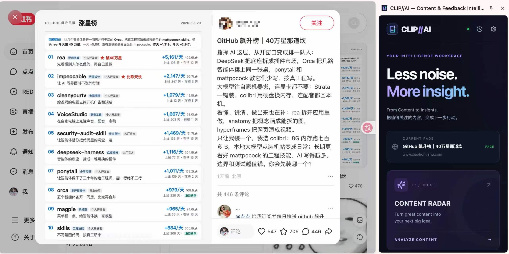
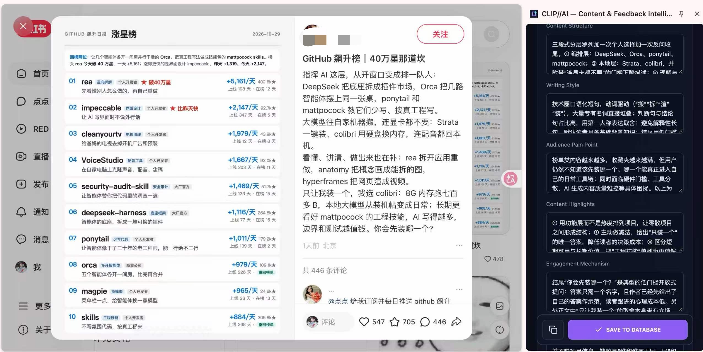
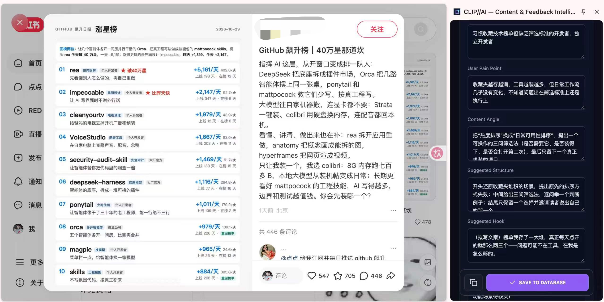

<p align="center"></p>
<h1 align="center">CLIP//AI</h1>
<p align="center"><strong>From Content to Insights.</strong></p>
<p align="center">把值得关注的内容，变成下一步行动。</p>

CLIP//AI 是一款面向产品经理、内容运营与用户研究人员的 AI Chrome 插件。在浏览网页时，将内容拆解为可复用的方法与新选题，将用户反馈提炼为清晰的痛点和潜在需求。



## 两个 Radar，两条工作流

### CONTENT RADAR · 从内容到选题

发现一篇值得研究的笔记，打开侧栏，采集并检查文字，再由 AI 拆解目标受众、标题技巧、内容结构、用户痛点和运营价值。



**IDEA REMIX** 结合你配置的目标产品、受众和运营方向，生成三个新的选题，包含切入角度、建议结构、开头文案与产品使用场景。分析和选题均可编辑，确认后保存。



### FEEDBACK RADAR · 从用户原话到产品洞察

选中网页上的反馈，右键 **Save to CLIP//AI → Analyze as Feedback**，或在侧栏手动粘贴。AI 提炼问题摘要、使用场景、痛点、潜在需求与改进建议，保留原话，区分用户事实与模型推测。

优先级只是 AI 的初步建议，信息不足时标记 **Needs More Context**，由你进一步核实。

## 功能

- 小红书公开可访问笔记及普通网页的主动文本采集，支持选文和手动输入。
- 内容拆解、三个运营新选题，以及结构化用户反馈提炼。
- 支持 **OpenAI / DeepSeek**，使用自己的 API Key，可测试连接和选择模型。
- 结果预览、字段编辑、本地历史记录、复制与导出。
- Chrome Side Panel，深色界面，支持减少动画。

## 安装

目前通过加载已解压扩展使用，尚未上架 Chrome Web Store。

1. 在仓库 **Releases** 下载插件 ZIP 并解压。
2. 打开 Chrome 的 `chrome://extensions`，开启「开发者模式」。
3. 点击「加载已解压的扩展程序」，选择解压后包含 `manifest.json` 的文件夹。
4. 将 CLIP//AI 固定到工具栏，打开一篇网页并点击插件图标。
5. 在 Settings 中选择服务商，填写自己的 Key 和模型名，点击 **Test Connection** 后保存。

默认模型名称只是可编辑起点，实际可用性取决于你的服务商账户。不要在 Issue、聊天或代码中公开自己的 Key。

## 使用

**内容分析**：打开笔记 → CONTENT RADAR → 检查采集文字 → ANALYZE CONTENT → 编辑内容拆解与选题 → 保存。

使用 IDEA REMIX 前，可在 Settings → Content Preferences 填写目标产品、真实功能、受众与内容目标。资料不足的产品能力需要核实，不应将 AI 建议当成已验证的产品事实。

**反馈提炼**：选中文字并右键采集，或进入 FEEDBACK RADAR 粘贴 → 检查原话 → EXTRACT INSIGHTS → 编辑并保存。

**本地记录**：历史入口支持查看、删除、复制和导出。导出格式为 CSV。

### 采集提示

- 只处理用户主动打开、合法可访问的网页，不绕过登录、验证码或访问控制。
- 读取失败时，回到网页重新点击工具栏图标；小红书也可使用「授权读取小红书」授予可选站点权限。
- 本版采集网页文字，暂不支持配图 OCR。图文笔记中仅存在于图片里的内容需要手动提供。
- DOM 会随网站更新，采集后请检查文字是否完整、是否含无关内容；失败时可手动粘贴。
- 不编造点赞、收藏、评论数。内容设计的成效分析属于 AI 假设。

## 隐私与数据

API 请求由扩展 Service Worker 发起，Key 不传入网页脚本。两家服务商的 Key 独立存储，默认仅保存在当前浏览器会话；主动开启 Remember Key 才会保存在设备本地。Remove Key 删除当前服务商的 Key。

只有确认分析后，待分析文字和产品资料才会发给所选服务商，相关费用由你的 API 账户承担。提交前请删除个人敏感信息和企业机密。客户端密钥存储不具备服务器密钥保险库级别的安全保障。

结果需用户确认后才本地保存。内容研究不默认保留整篇网页正文；反馈记录保留原话。最多 200 条主记录，支持删除和清空。关闭侧栏会丢失未保存表单。

当前版本未提供 WPS 云端同步。更多说明见 [隐私说明](docs/PRIVACY.md)。

## 本地开发

需要 Node.js 22.12+、npm 和 Chrome 116+。

```sh
npm ci
npm run typecheck
npm test
npm run build
```

构建输出为 `dist/`，在 Chrome 加载该目录即可。更新后重新构建，并在扩展管理页点击「重新加载」。

`npm run dev` 可用于界面预览；普通网页环境没有扩展权限，完整功能需要在已安装的扩展中测试。

技术栈：Manifest V3、React、TypeScript、Vite、Tailwind CSS、Motion、Lucide、Zod。

```text
src/
  ai.ts            # 服务商请求、提示词、结果校验
  background.ts    # 扩展后台、密钥、右键菜单与存储
  pageCapture.ts   # 当前标签页与采集错误处理
  extract.ts       # 按需注入的文本提取函数
  domain.ts        # 数据模型和 Zod Schema
  csv.ts           # 数据导出
  main.tsx         # 侧栏、设置、预览与历史
  style.css        # 品牌界面
```

## 测试与边界

自动测试覆盖结构校验、原话保留、关联选题、导出格式、服务商错误处理、密钥隔离和页面权限分支。详见 [测试清单](docs/TESTING.md)。用户已反馈小红书读取正常，配图展示实际使用过程；自动化模拟测试不代表所有网站与账户均已完成在线验收。

发现问题可提交 Issue，请提供 Chrome 版本、插件版本、复现步骤与脱敏截图，不要附带 API Key 或私人页面内容。
